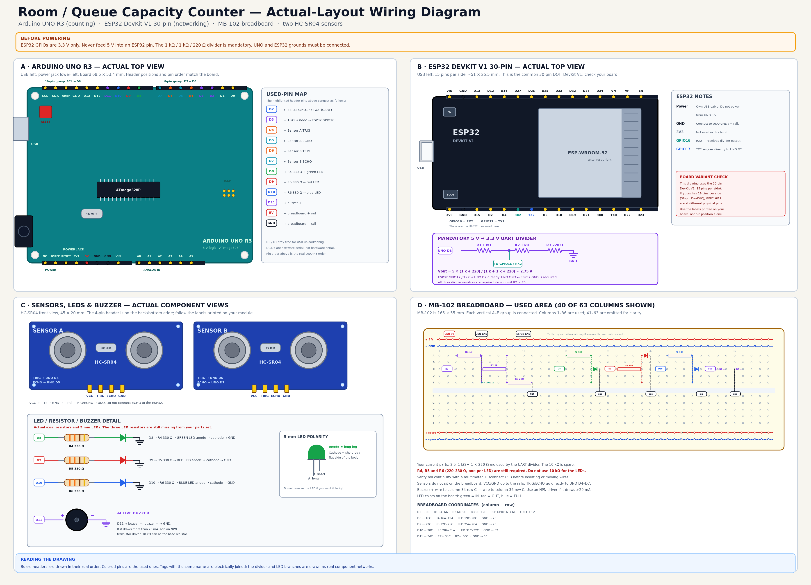

# Room / Queue Capacity Counter

A local IoT mini-project that counts people entering or leaving a room, or counts the length of a queue, using two HC-SR04 ultrasonic sensors.

- **Arduino UNO** handles the sensors, counting logic, LEDs and buzzer.
- **ESP32 DevKit V1** handles networking and serves a local web dashboard.
- **No cloud or MQTT** is used in this version.
- The hosted dashboard can be added later without changing the UNO firmware.



---

## Features

- Room mode: detects direction using sensor order
  - Sensor A then B → entry
  - Sensor B then A → exit
- Queue mode:
  - Sensor A → queue in / count +1
  - Sensor B → queue out / count −1
- Adjustable capacity and detection threshold
- Count correction and reset from the dashboard
- Green, red and blue LED indicators
- Active-low buzzer feedback
- Local web dashboard served by the ESP32
- Live sensor distances and threshold markers
- Last 20 events with relative timestamps
- ESP32 diagnostics: IP, RSSI, uptime, heap, UNO link age
- Automatic access-point fallback if Wi-Fi fails

---

## Hardware

| Part | Purpose |
|---|---|
| Arduino UNO | Sensor reading, counting, LEDs, buzzer |
| ESP32 DevKit V1 30-pin | Wi-Fi and local HTTP dashboard |
| 2 × HC-SR04 | Direction / queue sensors |
| 3-pin active buzzer module | Audible feedback |
| Green LED | Valid IN |
| Red LED | Valid OUT |
| Blue LED | At capacity |
| 3 × 220–330 Ω resistors | LED current limiting |
| 2 × 1 kΩ + 1 × 220 Ω | UNO D3 → ESP32 GPIO16 divider |
| 1 × 10 kΩ | Spare |
| MB-102 breadboard | Prototyping |
| Jumper wires | Connections |

> **LEDs must not be connected directly to the UNO pins.** Each bare LED needs a series resistor.

> The buzzer is a **3-pin active-low module**: `VCC` to 5 V, `GND` to GND, `I/O` to D11. `I/O = LOW` sounds.

---

## Wiring

Full wiring guide:

- [`hardware/wiring-guide.pdf`](hardware/wiring-guide.pdf)

### Pin map

| Signal | UNO pin |
|---|---|
| Sensor A TRIG | D4 |
| Sensor A ECHO | D5 |
| Sensor B TRIG | D6 |
| Sensor B ECHO | D7 |
| Green LED | D8 |
| Red LED | D9 |
| Blue LED | D10 |
| Buzzer I/O | D11 |
| ESP32 UART RX | D2 |
| ESP32 UART TX | D3 |

ESP32 side:

| Signal | ESP32 pin |
|---|---|
| UART RX | GPIO16 |
| UART TX | GPIO17 |
| Ground | GND |

The UNO D3 signal must go through the **1 kΩ → 1 kΩ + 220 Ω divider** before reaching ESP32 GPIO16. Never connect UNO 5 V directly to an ESP32 GPIO.

The UNO and ESP32 grounds must be connected together.

---

## Architecture

```text
HC-SR04 A/B
     │
     ▼
Arduino UNO
  sensor debounce
  room/queue state machine
  count + totals
  LEDs + buzzer
     │
     │ 9600 baud UART
     ▼
ESP32 DevKit V1
  UART2: GPIO16 RX / GPIO17 TX
  Wi-Fi
  HTTP server
  embedded dashboard
     │
     ▼
Browser on the same LAN
  http://<ESP32-IP>/
```

The UNO owns the count. The ESP32 only receives state/events, sends commands, and serves the dashboard.

---

## Repository layout

```text
code/
  uno/room_counter/          UNO production firmware
  esp32/local_dashboard/     ESP32 local HTTP server
    dashboard_html.h         generated dashboard header
    secrets.example.h        Wi-Fi credential template
    secrets.h                local credentials (git-ignored)

dashboard/
  index.html                 dashboard UI source

firmware/
  README.md                  hardware test guide
  uno/                       UNO test sketches
  esp32/                     ESP32 test sketches

hardware/
  wiring-guide.pdf           printable wiring guide
  circuit-wiring-v2.svg      complete layout
  wiring-0*.svg              step-by-step direct wiring

tools/
  embed_dashboard.py         embeds dashboard/index.html into the ESP32 header
```

Detailed production notes: [`code/README.md`](code/README.md)  
Hardware test guide: [`firmware/README.md`](firmware/README.md)

---

## Quick start

### 1. Wire the hardware

Follow [`hardware/wiring-guide.pdf`](hardware/wiring-guide.pdf).

If your breadboard power rails are split, bridge the `+` and `−` rails across the split. This is a common cause of “one side works, the other doesn’t.”

### 2. Run the hardware tests

Follow [`firmware/README.md`](firmware/README.md).

Recommended order:

1. UNO LEDs and buzzer
2. Both ultrasonic sensors
3. UNO ↔ ESP32 UART
4. ESP32 Wi-Fi scan

The production firmware assumes these pass.

### 3. Configure Wi-Fi

Copy the template:

```bash
cp code/esp32/local_dashboard/secrets.example.h \
   code/esp32/local_dashboard/secrets.h
```

Edit `code/esp32/local_dashboard/secrets.h`:

```cpp
#define WIFI_SSID "your-2.4GHz-network"
#define WIFI_PASSWORD "your-password"
```

Use a **2.4 GHz** network.

If the connection fails, the ESP32 creates:

- SSID: `RoomCounter`
- Password: `counter1234`
- Dashboard: `http://192.168.4.1/`

### 4. Upload the UNO

Open:

`code/uno/room_counter/room_counter.ino`

Arduino IDE settings:

- Board: **Arduino Uno**
- Port: `/dev/ttyUSB0` (CH340 on this PC)

### 5. Upload the ESP32

Open:

`code/esp32/local_dashboard/local_dashboard.ino`

Arduino IDE settings:

- Board: **DOIT ESP32 DEVKIT V1**
- Port: `/dev/ttyUSB1` (CP2102 on this PC)

If upload fails, hold **BOOT** while starting the upload.

### 6. Open the dashboard

Open the ESP32 Serial Monitor at **115200 baud**:

```text
Wi-Fi connected. Dashboard: http://192.168.1.42
mDNS: http://roomcounter.local/
```

Open that URL in a browser on the same network.

Do not open `dashboard/index.html` directly from disk—the page must be served by the ESP32.

No SPIFFS/LittleFS upload is required. The dashboard is embedded in the ESP32 firmware.

---

## Using the dashboard

### Room mode

- Sensor A = outside
- Sensor B = inside
- A → B: count +1
- B → A: count −1

### Queue mode

- Sensor A = queue in
- Sensor B = queue out
- A edge: count +1
- B edge: count −1

### Controls

| Control | Effect |
|---|---|
| Room / Queue | Changes the counting mode |
| Capacity | Sets the full threshold (1–99) |
| Detection threshold | Sets the distance trigger point (10–300 cm) |
| Correct count | Sets the current count directly |
| Reset count | Sets count to zero; totals remain |
| Test buzzer | Sends a beep command |

### Detection threshold

Default: **80 cm**.

A sensor is considered active after two consecutive readings at or below the threshold. It clears after three consecutive readings above `threshold + 12 cm`.

Use the live distance bars to calibrate the threshold for your doorway or queue.

### LED behaviour

| LED | Meaning |
|---|---|
| Green | Valid IN / entry |
| Red | Valid OUT / exit |
| Blue | At or over capacity |

### Buzzer behaviour

| Event | Pattern |
|---|---|
| IN | One short beep |
| OUT | Two short beeps |
| Full | One long beep |
| Invalid OUT at zero | Three short beeps |

The module is active-low.

---

## UNO ↔ ESP32 protocol

UNO → ESP32, newline-terminated:

```text
S,count,mode,capacity,in,out,distA,distB,threshold,flags,seq,millis
E,seq,type,delta,count,millis
A,verb,OK|ERR
```

ESP32 → UNO:

```text
C,MODE,ROOM
C,MODE,QUEUE
C,CAP,10
C,RESET
C,CORRECT,5
C,THRESH,80
C,BEEP
C,STATUS
```

`flags` bits:

| Bit | Meaning |
|---|---|
| 0 | Sensor A active |
| 1 | Sensor B active |
| 2 | Full |
| 3 | Sensor A fault / no echo |
| 4 | Sensor B fault / no echo |

`seq` values:

| Value | State |
|---|---|
| 0 | Idle |
| 1 | A detected first |
| 2 | B detected first |
| 3 | Waiting for clear |
| 4 | Ambiguous |

The ESP32 adds its own uptime and received timestamps; the dashboard shows event age relative to the ESP32 uptime.

---

## Dashboard source

The UI source is:

`dashboard/index.html`

After editing it, regenerate the embedded header:

```bash
python3 tools/embed_dashboard.py
```

Then re-upload the ESP32 sketch.

The dashboard uses only the ESP32’s HTTP server and plain browser APIs. There are no external fonts, CDNs, or JavaScript frameworks.

---

## Notes and limitations

- The UNO count is held in RAM and resets to zero after an UNO reset.
- Capacity, mode, totals and threshold are also RAM-only in this version.
- HC-SR04 sensors are not perfect for crowds, tailgating, or simultaneous crossings.
- The room state machine rejects ambiguous simultaneous activation and logs invalid/timeout events.
- A queue OUT at zero is recorded as `INVALID`; the count does not go below zero.
- The ESP32 dashboard is local-only. There is no authentication; keep it on a trusted LAN.
- The dashboard is not exposed to the internet.

---

## Troubleshooting

| Symptom | Check |
|---|---|
| Dashboard does not open | ESP32 and browser on same Wi-Fi; use IP from ESP32 Serial Monitor |
| Dashboard shows `UNO link lost` | UNO power, common GND, D3 divider, GPIO16/17 |
| Count never changes | Live sensor distances, threshold, sensor placement |
| Count changes in the wrong direction | Swap sensor A/B signal wires or sensor placement |
| Buzzer silent | Active-low module, VCC/GND, D11 |
| LEDs do not light | D8/D9/D10, LED polarity, series resistors |
| ESP32 resets when buzzer sounds | Check 5 V supply and common ground |
| Wi-Fi does not connect | 2.4 GHz network, credentials, or use `RoomCounter` fallback AP |
| One breadboard side works, the other does not | Bridge split power rails with jumpers |

---

## Future hosted dashboard

The stable boundary is the **UNO UART protocol**. To move to a hosted dashboard later:

1. Keep the UNO firmware and UART format unchanged.
2. Replace the ESP32 HTTP layer with MQTT or HTTPS.
3. Move the dashboard UI to a hosted frontend.
4. Add a backend and database for history, authentication and multi-device support.

This keeps the hardware logic isolated from the hosting choice.
